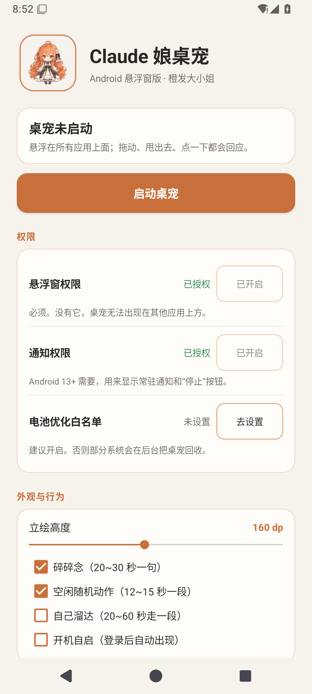
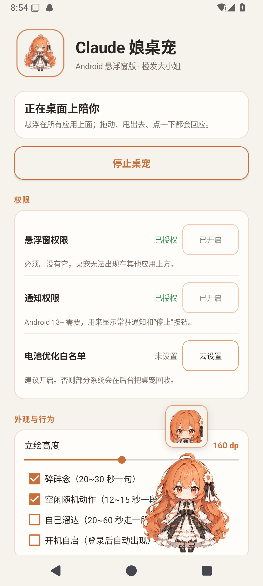
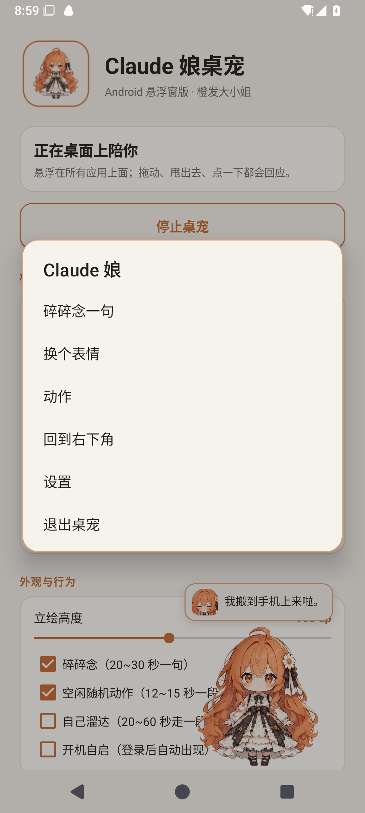

# claude-chan-pet-android

[](https://github.com/Mushan08/claude-chan-pet-android/actions/workflows/android.yml)
[下载 APK](https://github.com/Mushan08/claude-chan-pet-android/releases/latest)

把 `claude-chan-pet` 从 Electron 桌面版移植到 Android：一只悬浮在所有应用上面的 Claude 娘，站在屏幕底部，可以拖、可以甩、会自己待机呼吸、会碎碎念，也会播抱玩偶 / 招手 / 比心 / 看书 / 想到办法五段透明动作。



| 悬浮在应用上 | 长按菜单 |
| --- | --- |
|  |  |

## 和桌面版的区别

| 项 | 桌面版 | Android 版 |
| --- | --- | --- |
| 外壳 | Electron 透明窗 | `TYPE_APPLICATION_OVERLAY` 悬浮窗 + 前台服务 |
| 位置 / 拖拽 / 抛掷 | 主进程移窗口 | `PetService` 用 `WindowManager` 移窗口，原生命中 |
| 渲染 | 本地 HTML/JS | 同一个 WebView 页面，资源内置在 APK |
| 动作片段 | VP9 alpha WebM | **透明 animated WebP**（Android MediaCodec 会丢 VP9 alpha） |
| Claude Code hooks | 读 `events.jsonl` | 不适用；目前是独立桌宠 |
| 右键菜单 | Electron Menu | 长按弹原生 AlertDialog |
| 跟随 Claude 开关 | 监听 `claude.exe` | Android 上没有对应进程 |

## 目录

```
app/src/main/java/com/coldcoffee/claudechan/
  MainActivity.java   权限引导 + 设置页
  PetService.java     悬浮窗、拖拽、抛掷、溜达、菜单
  BootReceiver.java   可选开机自启
  Prefs.java          SharedPreferences
app/src/main/assets/pet/
  index.html / pet.css / pet.js
  front.png side.png back.png faces/
  anims/*.webp        由 tools/convert_anims.py 生成
tools/
  convert_anims.py    WebM -> animated WebP（保留 alpha）
  make_icons.py        启动图标 / 通知小图标
  build-apk.ps1        不依赖 Gradle 的 CLI 构建
```

## 构建

### Android Studio

1. 用 Android Studio 打开本目录。
2. JDK 17，SDK 35，Build-Tools 35.0.0。
3. Run `app`。

### 命令行（不需要 Gradle）

需要 JDK 17、Android SDK platform 35、build-tools 35.0.0，以及 Python 3
（`tools/add_dex.py` 用来把 `classes.dex` 塞进 aapt2 产出的 APK）：

```powershell
pwsh -NoProfile -File tools/build-apk.ps1 `
  -JdkHome E:\android-toolchain\jdk-17 `
  -SdkRoot E:\android-toolchain\sdk
```

产物：`dist/claude-chan-pet-android-0.1.0.apk`。

```powershell
adb install -r dist\claude-chan-pet-android-0.1.0.apk
```

命令行构建和 Android Studio 的 debug 构建都使用 `%USERPROFILE%\.android\debug.keystore`，
签名一致，可以互相覆盖安装。换 release 签名时记得先卸载 debug 版。

## 第一次启动

1. 点「去授权」，在系统设置里允许**显示在其他应用上层**。
2. Android 13+ 再给通知权限（常驻通知里有停止按钮）。
3. 建议把电池优化设为「不限制」，否则部分国产系统会在后台杀掉悬浮窗。
4. 回到 App 点「启动桌宠」。

首次启动后，桌宠默认站在右下角。长按弹出菜单：碎碎念 / 换表情 / 动作 / 回到右下角 / 设置 / 退出。

## 重新生成动作片段

透明 WebM 在 Android 上会因为 MediaCodec 丢掉 alpha 通道，所以构建前先转成 animated WebP：

```powershell
python -m pip install imageio-ffmpeg
python tools/convert_anims.py
```

脚本用 `ffmpeg -c:v libvpx-vp9` 解出 `yuva420p` 的 97 帧，再用 Pillow 编码成 480p、24fps 的透明 WebP。输出在 `app/src/main/assets/pet/anims/`。

## 已知边界

- **独立版**：手机上没有 Claude Code，所以不会跟着会话换表情。下一步可以在电脑端开一个局域网 WebSocket，把 hook 事件推给手机。
- 悬浮窗是矩形的，立绘周围的透明角仍会吃触摸；这是 Android 悬浮窗没有逐像素命中测试的代价。
- 国产 ROM 的后台限制差异很大；如果桌宠消失，先检查电池优化 / 自启动权限。
- 动作 WebP 约 17 MB，APK 约 19 MB。要更小可以降 `tools/convert_anims.py` 里的 `HEIGHT` 或 `QUALITY`。

## 已验证

在 Android 15（API 35）x86_64 模拟器、1080×2400 / 420 dpi 上实机跑过：

- 权限引导、悬浮窗授权、通知授权
- 悬浮在所有应用上方、透明背景、贴任务栏上沿
- 拖拽、甩抛、重力/落地回弹、左右边界
- 长按菜单：碎碎念 / 换表情 / 动作 / 回到右下角 / 退出
- 5 段透明 WebP 动作、点击 Q 弹、随机碎碎念
- 横竖屏切换：横屏贴右侧工作区，转回竖屏自动回到底部
- 停止后再次启动、通知栏常驻通知

未在真机上验证：开机自启、电池优化白名单、通知栏“停止”按钮。代码路径已接好，
但国产 ROM 的后台策略差异很大，建议真机再确认一次。

## 下一步：局域网事件桥（未实现）

如果希望手机上的桌宠跟着电脑里的 Claude Code 换表情：

1. 桌面版在 `0.0.0.0:8765` 开一个 SSE/HTTP 端点，把 `setState` 事件广播出去。
2. Android 设置页加一个“电脑地址”输入框（如 `192.168.1.10:8765`）。
3. `PetService` 用 `HttpURLConnection` 读 `text/event-stream`，解析 `data: {"state":"working"}`。
4. WebView 增加 `PetHost.setState(state, text, face)`，复刻桌面版的状态→姿势/表情/片段映射。

这样手机只负责显示，事件仍然来自电脑端，不需要在手机上跑 Claude Code。
